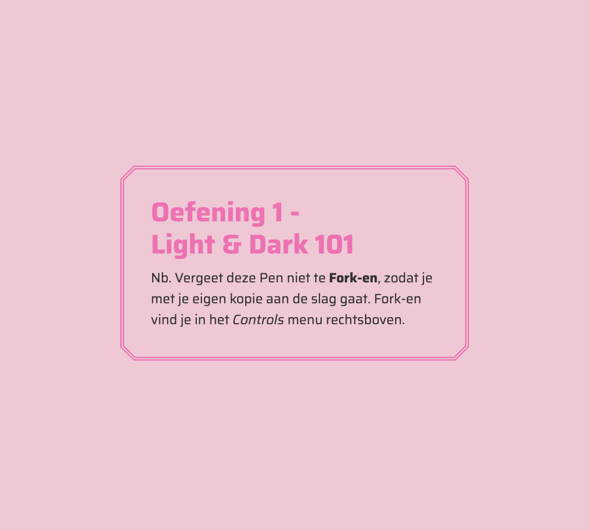

SPRINT 0- GETTING A GRIP

S0 - Interactie: Wok To Walk bestelformulier opdracht

Voor deze opdracht heb ik twee verschillende schetsen gemaakt voor het online bestelformulier van Wok to Walk. Bij de eerste schets heb ik gekozen voor een overzichtelijk formulier met vier stappen: basis, ingrediënten, saus en drankje. Rechts staat een overzicht van de bestelling, zodat je meteen kunt zien wat je hebt gekozen en hoeveel het kost.
Bij de tweede schets heb ik gewerkt met grotere kaarten waarop je de verschillende opties kunt kiezen. Ik vind deze manier ook fijn, omdat het er wat speelser uitziet. Zelf vind ik de tweede schets mooier, maar de eerste schets is wat overzichtelijker.

S0 - Schetsen van o.a. interactie en animatie

Tijdens deze opdracht heb ik geoefend met het tekenen van rechte lijnen, vierkanten en rechthoeken. Ook heb ik mijn eigen telefoon op ware grootte nagetekend. Ik merkte dat het soms lastig was om alles netjes en recht te krijgen. Het was een goede oefening om nauwkeuriger te leren tekenen en beter op verhoudingen te letten.

S0 - Praktische CSS

Oefening 1- Een lelijke HTML pagina mooi maken

Voor deze opdracht heb ik een kleine website gemaakt over Resident Evil. Ik heb geoefend met HTML en CSS en geleerd hoe ik titels, teksten, afbeeldingen en links kan toevoegen. Ook heb ik een hover-effect gemaakt waarbij de link roze wordt en er een gestippeld kader omheen verschijnt als je er met je muis overheen gaat.

S0 - CSS: fonts met kleur en effecten

Oefening 1- Front Properties

Tijdens deze oefening heb ik geoefend met het aanpassen van lettertypes, de grootte van letters en de kleur. Ook heb ik geleerd hoe ik alleen de eerste letter van een tekst een andere stijl kan geven. Zo heb ik mijn tekst wat meer uitstraling kunnen geven.

Oefening 2 - Fonts, kleur en effecten

Tijdens deze oefening heb ik geëxperimenteerd met achtergrondkleuren en verschillende lettertypes. Ook heb ik een neonachtig effect gemaakt met tekstschaduw. Ik vond het leuk om te zien hoe je met kleuren en effecten een tekst meer kunt laten opvallen.

SPRINT 1- DIGITAL GARDEN

Oefening 1 - Light & Darkmode

Tijdens deze oefening heb ik geleerd om met custom properties te werken in CSS. Ik heb verschillende kleuren ingesteld voor de achtergrond, tekst en randen. Ook heb ik geleerd hoe ik met light-dark code een licht en donker thema kan maken. Door de instellingen van mijn Mac te veranderen, kon ik zien hoe de pagina automatisch van kleur verandert.
